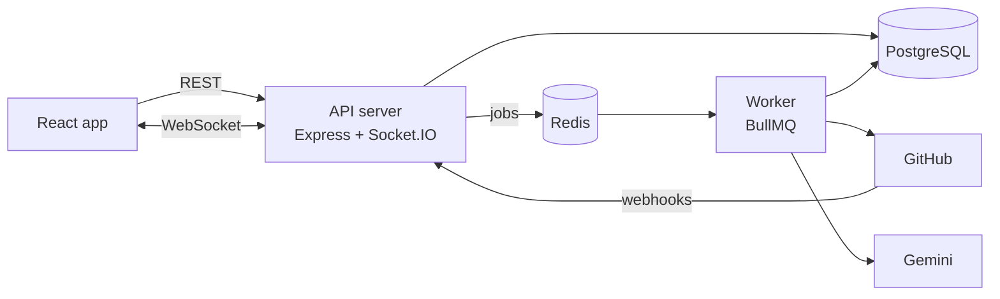

# DevPulse

**AI-powered engineering management platform.**

DevPulse helps software teams manage projects, track development progress, and understand engineering productivity. It connects to GitHub, organizes work into projects and sprints on a real-time Kanban board, and uses AI to summarize sprints and pull requests.

> Status: in development. See the [build roadmap](docs/architecture/20-build-roadmap.md).

## Features

- GitHub integration (repositories, commits, pull requests)
- Project and sprint management
- Kanban board with drag-and-drop
- AI-generated sprint summaries
- AI-powered PR summaries
- Developer activity analytics
- Real-time team collaboration
- Role-based access (Admin, Manager, Developer)
- Notifications and activity feeds

## Tech Stack

| Layer | Technology |
|---|---|
| Frontend | React 19, TypeScript, Vite, Tailwind CSS, TanStack Query, dnd-kit |
| Backend | Node.js, Express 5, TypeScript, Zod |
| Database | PostgreSQL, Prisma |
| Cache and queues | Redis, BullMQ |
| Real-time | Socket.IO |
| AI | Google Gemini API |
| DevOps | Docker, GitHub Actions, Terraform, AWS |

## Architecture at a Glance



The API handles fast requests and live updates. A separate worker handles slow work (GitHub sync, AI summaries, analytics) through Redis queues.

Full architecture documentation: **[docs/architecture](docs/architecture/00-index.md)**

## Project Structure

```
devpulse/
├── apps/
│   ├── web/          # React frontend
│   └── api/          # Express API + worker
├── packages/
│   └── shared/       # shared types and Zod schemas
├── infra/            # Terraform (AWS)
├── docs/architecture/
└── docker-compose.yml
```

## Quick Start

**Prerequisites:** Node.js 22 LTS, pnpm, Docker.

```bash
git clone https://github.com/<your-username>/devpulse.git
cd devpulse
pnpm install
docker compose up -d                     # PostgreSQL + Redis
cp apps/api/.env.example apps/api/.env   # fill in values
cp apps/web/.env.example apps/web/.env
pnpm --filter api db:migrate
pnpm --filter api db:seed
pnpm dev
```

- Frontend: http://localhost:5173
- API: http://localhost:4000

## Scripts

| Command | Description |
|---|---|
| `pnpm dev` | Run web, API, and worker |
| `pnpm build` | Build all apps |
| `pnpm lint` | Lint |
| `pnpm typecheck` | Type check |
| `pnpm test` | Run tests |

## License

MIT
