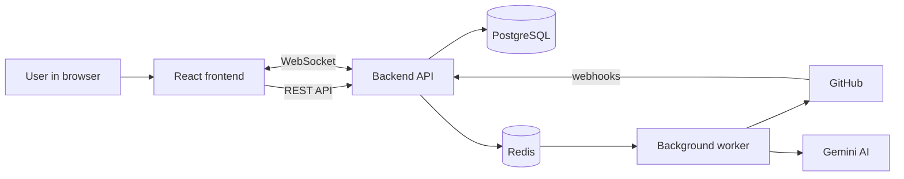

# 01. Overview

> DevPulse is a web app where software teams plan work, connect GitHub, and get AI summaries and productivity insights.

## In simple words

Teams usually juggle three tools: a task board (like Jira), GitHub, and spreadsheets or meetings for status updates. DevPulse puts them in one place:

- You plan tasks and sprints on a Kanban board.
- DevPulse watches your GitHub repositories and links commits and pull requests to the work.
- AI writes the boring summaries: what a sprint delivered and what a pull request changes.
- Charts show how the team is doing.

## Who uses it

| User | What they want |
|---|---|
| **Admin** | Set up the organization, invite people, connect GitHub. |
| **Manager** | Plan sprints, see progress, read AI summaries, view team analytics. |
| **Developer** | See their tasks, move cards, read PR summaries, view their own stats. |

## Core features

1. GitHub integration (repositories, commits, pull requests)
2. Project and sprint management
3. Kanban board with drag-and-drop
4. AI sprint summaries
5. AI pull request summaries
6. Developer activity analytics
7. Real-time collaboration
8. Role-based access (Admin, Manager, Developer)
9. Notifications and activity feed

## The big picture

You don't need to understand every box yet. File 03 explains each one.

## What "production-level" means for this project

A demo works on your laptop. A production app keeps working when real people use it at the same time, when things fail, and when you deploy new code. For DevPulse that means:

- **Secure**: hashed passwords, safe tokens, permission checks on every request, secrets kept out of code.
- **Reliable**: slow or failing outside services (GitHub, Gemini) don't break the app; failed jobs retry.
- **Scalable**: you can run more than one copy of the backend.
- **Observable**: logs and error tracking show what went wrong.
- **Tested and automated**: tests run on every change; deployment is one click or automatic.
- **Multi-tenant**: one organization can never see another organization's data.

Each later file ends with a production checklist that covers these points.

## Non-goals (for version 1)

Keeping the scope small helps you finish:

- No mobile app.
- No GitLab or Bitbucket (GitHub only).
- No billing or payments.
- No custom workflow builder (board columns are fixed).

## Interview talking points

- "I built a multi-tenant engineering management platform with GitHub integration, real-time collaboration, and AI summaries."
- "Slow work like AI calls and GitHub syncs runs in a background worker, so the API stays fast."

Next: [02. Tech Stack](02-tech-stack.md)
