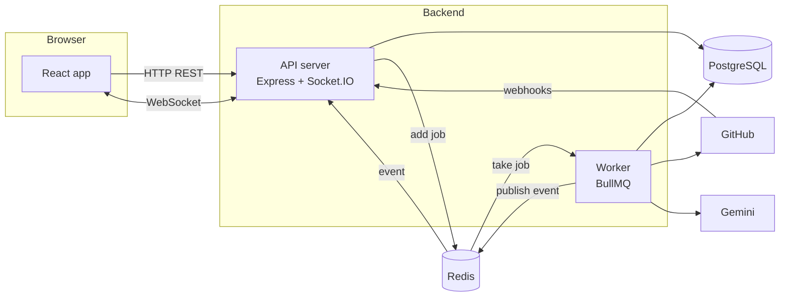

# 03. System Architecture

> The main pieces of DevPulse and how they communicate.

## In simple words

DevPulse has **three programs** you write and **two data stores**:

| Program | Job |
|---|---|
| **Web** (React) | Runs in the browser. Shows the UI. |
| **API** (Express + Socket.IO) | Answers requests fast. Pushes live updates. |
| **Worker** (BullMQ) | Does slow work in the background. |

| Data store | Job |
|---|---|
| **PostgreSQL** | Permanent data. The source of truth. |
| **Redis** | Fast temporary data, job queues, and messages between servers. |

The API and Worker share one codebase (`apps/api`) but start from different entry files (`server.ts` and `worker.ts`).

## The full picture

## Why split the API and the Worker

Some work is slow:

- Calling Gemini can take several seconds.
- Syncing a repository with thousands of commits can take minutes.
- GitHub can rate-limit you, which forces a wait.

If the API did this work while handling a request, users would wait and the server would get stuck. So:

1. The API **adds a job** to a Redis queue and replies right away ("summary is being generated").
2. The worker **takes the job**, does the work, and saves the result.
3. The worker **publishes an event**. The API hears it and pushes it to the browser over Socket.IO.

This is the **producer and consumer** pattern. The API produces jobs. The worker consumes them.

## The rule for deciding where code runs

| Runs in the API if | Runs in the Worker if |
|---|---|
| It finishes in well under a second | It may take seconds or minutes |
| The user needs the result right now | The user can be notified later |
| Example: move a task, add a comment | Example: AI summary, GitHub sync, analytics |

## Three ways the frontend gets data

1. **REST (pull)**: the browser asks, the server answers. Used for loading pages and saving changes.
2. **WebSocket (push)**: the server tells the browser something changed. Used for live board updates and notifications.
3. **Cache refresh**: when a push event arrives, the frontend updates its TanStack Query cache, so the screen changes without a new request.

## Stateless API servers

The API server keeps **no user data in memory** between requests:

- Login state lives in a token the browser sends each time.
- Shared data lives in PostgreSQL or Redis.

Because of this, you can run two, five, or ten copies behind a load balancer, and any copy can handle any request. This is called **horizontal scaling**.

## What happens when something fails

| Failure | What the user sees | Why |
|---|---|---|
| Gemini is down | "Summary unavailable, retrying" | Job retries with backoff (file 10). |
| GitHub rate limit | Sync is delayed | Worker waits until the limit resets. |
| One API server crashes | Nothing | The load balancer sends traffic to the others. |
| Redis restarts | Live updates pause briefly | Socket.IO clients reconnect on their own. |
| PostgreSQL down | Error page | It is the source of truth. Production uses a managed database with a standby copy (file 19). |

## Interview talking points

- "I separated request handling from background processing using a Redis-backed job queue."
- "API servers are stateless, so they scale horizontally. Socket.IO uses a Redis adapter so events reach users on any server."
- "Failures in outside services are isolated to background jobs, which retry."

Next: [04. Backend Architecture](04-backend-architecture.md)
