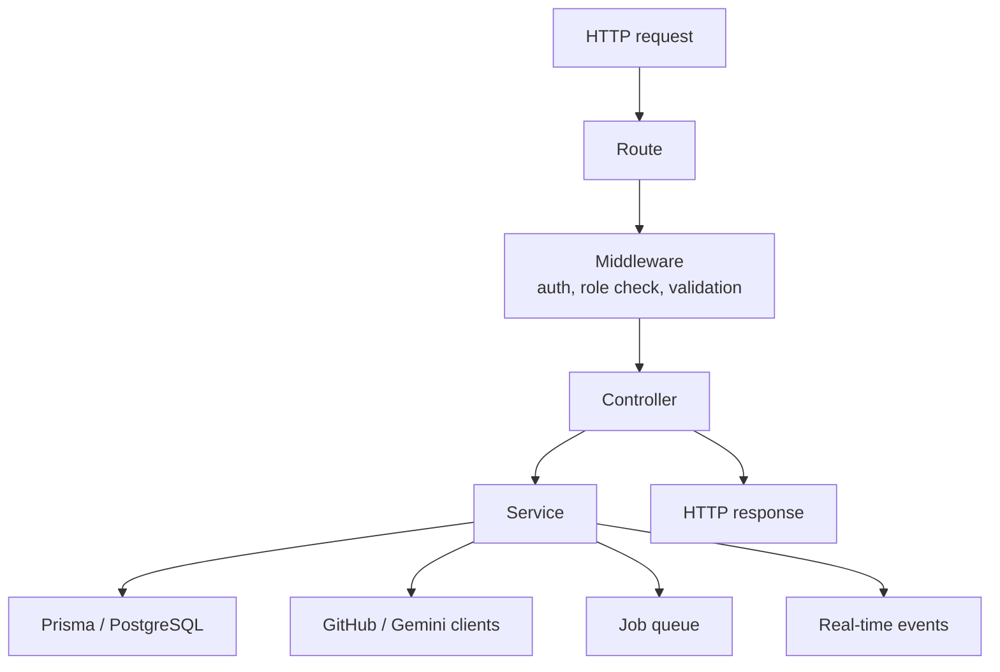

# 04. Backend Architecture

> How the code inside `apps/api` is organized.

## In simple words

The backend is split two ways:

- **By feature** (modules): `auth`, `projects`, `tasks`, `github`, and so on. Each feature lives in its own folder.
- **By layer** inside each feature: route, controller, service. Each layer has one job.

This is called a **modular monolith**: one deployable app, organized cleanly enough that a module could become its own service later.

## The layers



| Layer | Job | Must not |
|---|---|---|
| **Route** | Connect a URL and method to a controller, and attach middleware. | Contain logic. |
| **Middleware** | Check login, check role, validate input. | Contain business rules. |
| **Controller** | Read validated input, call the service, send the response. | Talk to the database directly. |
| **Service** | Business rules. Talks to the database, queue, and events. | Know about `req` or `res`. |

**Why bother?** Services don't depend on Express, so you can test them directly and call them from the worker too.

## Folder structure

```
apps/api/
├── prisma/
│   ├── schema.prisma
│   ├── migrations/
│   └── seed.ts
├── src/
│   ├── config/
│   │   └── env.ts              # validated environment variables
│   ├── lib/
│   │   ├── prisma.ts           # one shared Prisma client
│   │   ├── redis.ts            # Redis connections
│   │   ├── logger.ts           # Pino logger
│   │   └── errors.ts           # AppError classes
│   ├── middleware/
│   │   ├── authenticate.ts     # verifies JWT
│   │   ├── authorize.ts        # checks role
│   │   ├── validate.ts         # runs Zod schemas
│   │   ├── requestId.ts        # adds an ID to each request
│   │   └── errorHandler.ts     # turns errors into JSON
│   ├── modules/
│   │   ├── auth/
│   │   │   ├── auth.routes.ts
│   │   │   ├── auth.controller.ts
│   │   │   ├── auth.service.ts
│   │   │   ├── auth.schemas.ts
│   │   │   └── auth.test.ts
│   │   ├── organizations/
│   │   ├── projects/
│   │   ├── sprints/
│   │   ├── tasks/
│   │   ├── comments/
│   │   ├── github/
│   │   ├── ai/
│   │   ├── analytics/
│   │   └── notifications/
│   ├── realtime/
│   │   ├── socket.ts           # Socket.IO server setup
│   │   └── emit.ts             # helpers to send events
│   ├── jobs/
│   │   ├── queues.ts           # queue definitions
│   │   └── processors/         # one file per job type
│   ├── app.ts                  # builds the Express app
│   ├── server.ts               # starts HTTP + Socket.IO
│   └── worker.ts               # starts the worker
└── tests/
```

## Configuration

All settings come from environment variables, checked at startup with Zod:

```ts
// src/config/env.ts
const envSchema = z.object({
  NODE_ENV: z.enum(["development", "test", "production"]),
  PORT: z.coerce.number().default(4000),
  DATABASE_URL: z.string().url(),
  JWT_ACCESS_SECRET: z.string().min(32),
  // ...
});
export const env = envSchema.parse(process.env);
```

If a variable is missing, the app **refuses to start** with a clear message. That is far better than crashing later in production.

## Error handling

There is one error class family and one error handler.

```ts
class AppError extends Error {
  constructor(public statusCode: number, public code: string, message: string) {
    super(message);
  }
}
// NotFoundError (404), ForbiddenError (403), ValidationError (400), ConflictError (409)...
```

- Services `throw new NotFoundError("Task not found")`.
- Express 5 passes errors from `async` handlers to the error handler automatically.
- The error handler returns a consistent JSON shape (see file 08). For unknown errors it logs the details and returns a generic 500. It never sends a stack trace to the client.

## Multi-tenancy rule

Every organization's data is separate. **Every query for business data filters by `organizationId`.**

```ts
// Wrong: any logged-in user could read any task by guessing an ID
prisma.task.findUnique({ where: { id } });

// Right
prisma.task.findFirst({ where: { id, project: { organizationId: req.auth.orgId } } });
```

This is the most important security rule in the backend. Tests check it (file 17).

## Transactions

When one action changes several tables, wrap it in a transaction so either all changes save or none do:

```ts
await prisma.$transaction([
  prisma.task.update(...),
  prisma.activity.create(...),
]);
```

## Graceful shutdown

When AWS deploys a new version, it sends the old container a `SIGTERM` signal. The app should:

1. Stop accepting new requests.
2. Finish requests already in progress.
3. Close Socket.IO, Prisma, and Redis connections.
4. Exit.

The worker does the same: it finishes its current job before exiting. Without this, deployments cut off users mid-request.

## Production checklist

- [ ] Environment variables validated at startup
- [ ] Central error handler with a consistent JSON error shape
- [ ] Every business query scoped by `organizationId`
- [ ] Transactions for multi-table writes
- [ ] Request ID on every log line
- [ ] Graceful shutdown on `SIGTERM`
- [ ] One shared Prisma client (no new client per request)

## Interview talking points

- "I used a modular monolith with a route, controller, and service layering. Services are framework-free, so the worker reuses them."
- "Tenant isolation is enforced in every query and covered by tests."

Next: [05. Frontend Architecture](05-frontend-architecture.md)
