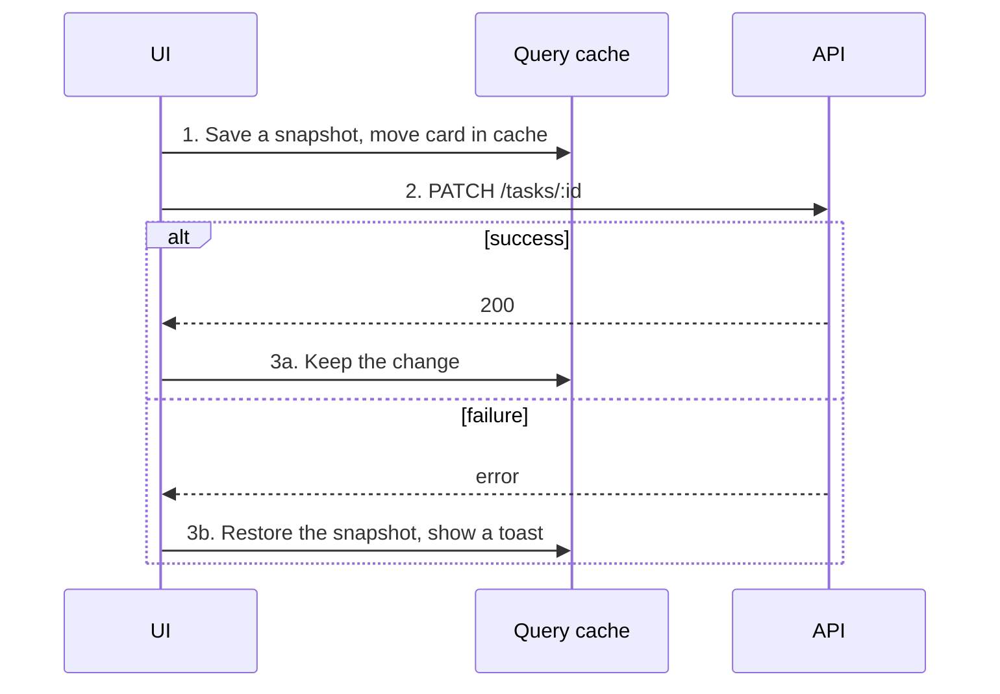

# 05. Frontend Architecture

> How the React app in `apps/web` is organized.

## In simple words

- Code is grouped **by feature** (board, sprints, analytics), not by file type.
- **TanStack Query** handles all data that comes from the server.
- **React state** handles small UI things like "is this modal open".
- **Socket.IO events** update the cached data, so changes from teammates appear live.

## Two kinds of state

| Kind | Example | Where it lives |
|---|---|---|
| **Server state** | Tasks, sprints, users | TanStack Query cache |
| **UI state** | Modal open, selected tab, search text | `useState` or the URL |

A common beginner mistake is copying server data into Redux or `useState`. Then the copy goes stale. TanStack Query avoids this: it keeps one cache and refetches when needed.

## Folder structure

```
apps/web/src/
├── app/
│   ├── router.tsx            # all routes
│   ├── providers.tsx         # QueryClient, Auth, Socket, Theme
│   └── layouts/              # AppLayout (sidebar + header), AuthLayout
├── features/
│   ├── auth/
│   │   ├── api.ts            # login(), register(), refresh()
│   │   ├── hooks.ts          # useLogin(), useCurrentUser()
│   │   ├── components/
│   │   └── pages/LoginPage.tsx
│   ├── projects/
│   ├── board/
│   │   ├── components/       # Board, Column, TaskCard
│   │   ├── hooks.ts          # useBoard(), useMoveTask()
│   │   └── realtime.ts       # socket listeners for this feature
│   ├── sprints/
│   ├── github/
│   ├── analytics/
│   └── notifications/
├── components/ui/            # Button, Input, Modal, Badge (shared, no business logic)
├── lib/
│   ├── apiClient.ts          # fetch wrapper: base URL, token, refresh on 401
│   ├── queryClient.ts
│   ├── queryKeys.ts          # all query keys in one place
│   └── socket.ts
└── main.tsx
```

Shared request and response types come from `packages/shared`, so the frontend and backend use the same definitions.

## Query keys

Query keys name each piece of cached data. Keep them in one file so they stay consistent:

```ts
export const queryKeys = {
  projects: (orgId: string) => ["projects", orgId] as const,
  board: (projectId: string) => ["board", projectId] as const,
  task: (taskId: string) => ["task", taskId] as const,
};
```

## Optimistic updates (Kanban)

When you drag a card, it should move instantly, not after a network round trip.



TanStack Query supports this with the `onMutate`, `onError`, and `onSettled` options of `useMutation`.

## Real-time updates

```ts
socket.on("task:moved", (data) => {
  queryClient.setQueryData(queryKeys.board(data.projectId), (old) => applyMove(old, data));
});
```

Ignore events caused by your own action, or the card might jump twice. The server includes an `actorId` in each event for this check.

## Routing and protected pages

```
/login
/register
/:orgSlug/projects
/:orgSlug/projects/:projectId/board
/:orgSlug/projects/:projectId/sprints
/:orgSlug/projects/:projectId/analytics
/:orgSlug/settings          (Admin only)
```

A `<RequireAuth>` wrapper sends logged-out users to `/login`. A `<RequireRole>` wrapper hides admin pages. **These checks only help the user experience. The backend still enforces every permission.**

## Auth token handling

- The access token is kept **in memory** (a JavaScript variable), not in `localStorage`. A script injected by an attacker can't read `localStorage` if the token was never put there.
- The refresh token is in an **httpOnly cookie**, which JavaScript can't read at all.
- When the API returns 401, `apiClient` calls `/auth/refresh` once, then retries the request.

Details are in file 07.

## Performance

- **Code splitting**: load each page's code only when visited (`React.lazy`). Analytics charts are heavy and shouldn't slow down the login page.
- **Sensible `staleTime`** in TanStack Query so data isn't refetched on every focus.
- **Pagination or virtualization** for long lists such as activity feeds.

## Production checklist

- [ ] Error boundary per page with a friendly fallback
- [ ] Loading skeletons and empty states
- [ ] Access token in memory, refresh token in an httpOnly cookie
- [ ] Code splitting by route
- [ ] Accessible drag-and-drop (keyboard support, which dnd-kit provides)
- [ ] Sentry for frontend errors
- [ ] Environment config through `VITE_*` variables only (never put secrets in frontend code)

## Interview talking points

- "I separated server state from UI state. TanStack Query owns server data, and socket events patch the cache directly."
- "The Kanban board uses optimistic updates with rollback on failure."

Next: [06. Database Design](06-database-design.md)
