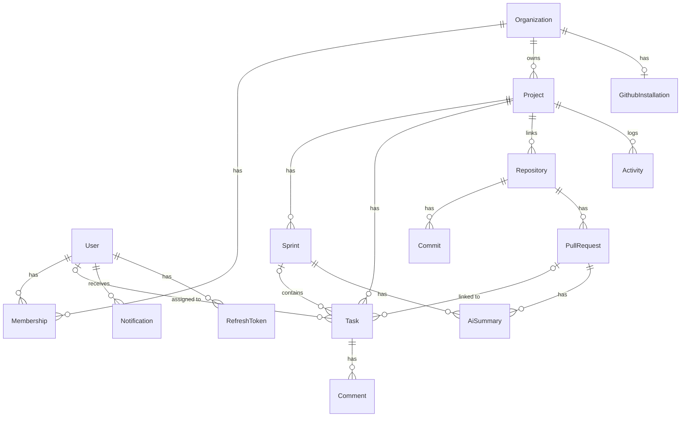

# 06. Database Design

> The tables, how they connect, and the rules that keep data safe and fast.

## In simple words

PostgreSQL stores everything permanent. Prisma describes the tables in one file (`schema.prisma`) and generates TypeScript types and migration files from it.

The data is organized as a tree. Everything hangs off an **Organization**:

```
Organization
├── Members (users with a role)
├── Projects
│   ├── Sprints
│   ├── Tasks ── Comments
│   ├── Repositories ── Commits, Pull Requests ── AI Summaries
│   └── Activity
└── GitHub Installation
```

## Entity relationship diagram



## Tables

| Table | Key columns | Notes |
|---|---|---|
| `User` | email, name, passwordHash, githubUserId | Password is optional if the user signs in with GitHub. |
| `Organization` | name, slug | `slug` is used in URLs. |
| `Membership` | userId, organizationId, role | Role is `ADMIN`, `MANAGER`, or `DEVELOPER`. Unique on (userId, organizationId). |
| `Project` | organizationId, name, key | `key` like "DP" makes task IDs like DP-42. |
| `Sprint` | projectId, name, goal, startDate, endDate, status | Status: `PLANNED`, `ACTIVE`, `COMPLETED`. |
| `Task` | projectId, sprintId?, assigneeId?, title, status, priority, position, storyPoints | `sprintId` empty means backlog. |
| `Comment` | taskId, authorId, body | |
| `GithubInstallation` | organizationId, installationId | Links the org to the GitHub App (file 11). |
| `Repository` | projectId, githubRepoId, fullName, defaultBranch | |
| `Commit` | repositoryId, sha, authorLogin, message, committedAt | Unique on (repositoryId, sha). |
| `PullRequest` | repositoryId, githubPrId, number, title, state, authorLogin, openedAt, mergedAt, additions, deletions | |
| `AiSummary` | type, sprintId?, pullRequestId?, content, model, promptVersion, status | Keeps history of summaries. |
| `Activity` | projectId, actorId, type, entityId, metadata (JSON) | Feed of what happened. |
| `Notification` | userId, type, payload (JSON), readAt | |
| `RefreshToken` | userId, tokenHash, familyId, expiresAt, revokedAt | For login sessions (file 07). |
| `WebhookDelivery` | deliveryId, event, receivedAt | Prevents processing the same GitHub event twice. |

## Prisma schema example

```prisma
enum Role { ADMIN MANAGER DEVELOPER }
enum TaskStatus { TODO IN_PROGRESS IN_REVIEW DONE }

model Membership {
  id             String       @id @default(uuid())
  userId         String
  organizationId String
  role           Role         @default(DEVELOPER)
  createdAt      DateTime     @default(now())
  user           User         @relation(fields: [userId], references: [id], onDelete: Cascade)
  organization   Organization @relation(fields: [organizationId], references: [id], onDelete: Cascade)

  @@unique([userId, organizationId])
  @@index([organizationId])
}

model Task {
  id          String     @id @default(uuid())
  projectId   String
  sprintId    String?
  assigneeId  String?
  number      Int                         // the 42 in DP-42
  title       String
  description String?
  status      TaskStatus @default(TODO)
  position    Float                       // order inside a column
  storyPoints Int?
  createdAt   DateTime   @default(now())
  updatedAt   DateTime   @updatedAt

  project     Project    @relation(fields: [projectId], references: [id], onDelete: Cascade)
  sprint      Sprint?    @relation(fields: [sprintId], references: [id], onDelete: SetNull)
  assignee    User?      @relation(fields: [assigneeId], references: [id], onDelete: SetNull)

  @@unique([projectId, number])
  @@index([projectId, status, position])
  @@index([sprintId])
  @@index([assigneeId])
}
```

## Design decisions explained

**1. Role lives on `Membership`, not on `User`.**
One person can be an Admin in their own organization and a Developer in a client's organization.

**2. `position` is a decimal number (Float).**
To drop a card between positions 1.0 and 2.0, give it 1.5. No other rows change. If the numbers get too close after many moves, a small job renumbers that column.

**3. UUIDs for IDs.**
Sequential IDs (1, 2, 3) let attackers guess other records and reveal how many you have. UUIDs don't.

**4. Store GitHub IDs and make them unique.**
`@@unique([repositoryId, sha])` means if a webhook arrives twice, the second insert is ignored instead of creating a duplicate. This is called **idempotency**.

**5. Indexes match the queries.**
The board query is "tasks in project X, grouped by status, ordered by position", so there is an index on `(projectId, status, position)`. Every foreign key used in a filter gets an index.

**6. `onDelete` rules are deliberate.**
Deleting a project deletes its tasks (`Cascade`). Deleting a sprint moves its tasks to the backlog (`SetNull`).

**7. Timestamps everywhere.**
`createdAt` and `updatedAt` on every table make debugging and analytics possible.

## Migrations

A migration is a SQL file that changes the database structure. Prisma creates them from your schema changes.

| Command | When |
|---|---|
| `prisma migrate dev` | Locally, when you change the schema. Creates a new migration file. |
| `prisma migrate deploy` | In CI/CD, before the new code starts. Applies pending migrations. |

Rules:

- Commit migration files to Git.
- Never edit a migration that has already run in production. Make a new one.
- For risky changes such as renaming a column, use two steps: add the new column and copy data, deploy, then remove the old column in a later release. This avoids downtime.

## Seeding

`prisma/seed.ts` creates a demo organization, users for each role, a project, a sprint, and tasks. This helps local development and makes demos easy.

## Production checklist

- [ ] Indexes on every foreign key and common filter
- [ ] Unique constraints for anything from GitHub
- [ ] Migrations run automatically in the deploy pipeline
- [ ] Automated daily backups with point-in-time recovery (AWS RDS)
- [ ] Connection pool size set for the number of API and worker containers
- [ ] No sensitive data stored in plain text (tokens hashed or encrypted)

## Interview talking points

- "I used fractional indexing for Kanban ordering, so a move updates one row."
- "GitHub data uses unique constraints, so duplicate webhooks are safe to replay."
- "Roles are per-organization through a membership table."

Next: [07. Auth and RBAC](07-auth-and-rbac.md)
