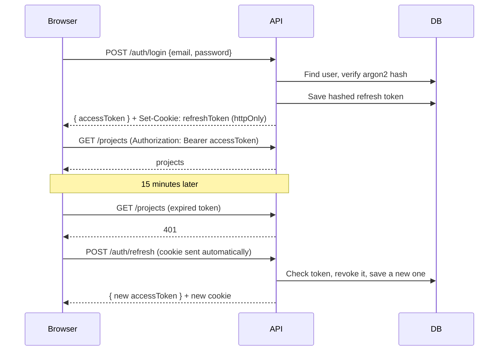

# 07. Auth and RBAC

> How users log in (authentication) and what they are allowed to do (authorization).

## In simple words

- **Authentication** answers "who are you?" Users log in with email and password, or with GitHub.
- **Authorization** answers "what can you do?" Each user has a role in each organization: Admin, Manager, or Developer. RBAC means **Role-Based Access Control**.

## Tokens: the two-token pattern

| Token | Lifetime | Stored where | Used for |
|---|---|---|---|
| **Access token** (JWT) | 15 minutes | Browser memory | Sent with every API request in the `Authorization` header |
| **Refresh token** | 7 to 30 days | httpOnly, Secure, SameSite cookie | Getting a new access token |

**Why two tokens?** A short access token limits damage if it leaks. The long refresh token keeps users logged in, and because it is in an httpOnly cookie, JavaScript (including an attacker's script) can't read it.

The access token contains only the basics:

```json
{ "sub": "user-id", "orgId": "org-id", "role": "MANAGER", "exp": 1730000000 }
```

## Login flow



## Refresh token rotation

Every time a refresh token is used, it is **replaced with a new one** and the old one is revoked.

If someone tries to use an **already revoked** token, it means the token was stolen and both the thief and the real user have a copy. The server then revokes the whole token family and the user must log in again. This is called **reuse detection**.

Refresh tokens are stored **hashed** in the database, so a database leak doesn't expose working tokens.

## GitHub login

Users can sign in with GitHub through OAuth:

1. The browser goes to GitHub's authorize page.
2. GitHub redirects back with a one-time `code` and the `state` value you sent.
3. The backend checks `state` (this blocks forged login requests), exchanges the code for the user's GitHub identity, then finds or creates the DevPulse user.
4. The backend issues the same two tokens as a normal login.

Repository access uses a **GitHub App**, which is separate from login. See file 11.

## Roles and permissions

| Action | Admin | Manager | Developer |
|---|:-:|:-:|:-:|
| Manage organization, members, roles | ✅ | | |
| Install GitHub App, link repositories | ✅ | ✅ | |
| Create, edit, delete projects | ✅ | ✅ | |
| Create, start, complete sprints | ✅ | ✅ | |
| Create, edit, move tasks | ✅ | ✅ | ✅ |
| Comment | ✅ | ✅ | ✅ |
| Generate AI sprint summary | ✅ | ✅ | |
| View AI PR summaries | ✅ | ✅ | ✅ |
| View team analytics | ✅ | ✅ | |
| View own analytics | ✅ | ✅ | ✅ |

## Permissions in code

Define **permissions**, not just roles. Routes ask for a permission, and one map says which roles have it:

```ts
const permissions = {
  "project:create":   ["ADMIN", "MANAGER"],
  "sprint:summarize": ["ADMIN", "MANAGER"],
  "task:move":        ["ADMIN", "MANAGER", "DEVELOPER"],
  "org:manage":       ["ADMIN"],
} as const;

router.post("/projects", authenticate, authorize("project:create"), validate(createProjectSchema), createProject);
```

**Why?** If you later add a "Viewer" role, you only edit the map, not every route.

## Three checks on every protected request

1. **Authenticate**: is the token valid and not expired?
2. **Authorize**: does this role have this permission?
3. **Scope**: does the requested record belong to the user's organization? (file 04)

Skipping step 3 is the most common real-world security bug. It is called **IDOR** (Insecure Direct Object Reference).

## Role changes take effect quickly

Roles are inside the access token, which lives 15 minutes. For sensitive actions (removing a member, changing roles), the backend re-reads the role from the database instead of trusting the token.

## Production checklist

- [ ] Passwords hashed with argon2
- [ ] Access token 15 minutes, in memory only
- [ ] Refresh token in an httpOnly, Secure, SameSite cookie, stored hashed, rotated, with reuse detection
- [ ] Rate limit on login, register, and refresh
- [ ] OAuth `state` checked
- [ ] Permission map, not hard-coded role checks
- [ ] Organization scoping on every query
- [ ] Logout revokes the refresh token
- [ ] Tests for "Developer cannot do Manager actions" and "User cannot read another org's data"

## Interview talking points

- "Short-lived access tokens in memory, rotating refresh tokens in httpOnly cookies, with reuse detection."
- "Permission-based RBAC with roles per organization, plus tenant scoping to prevent IDOR."

Next: [08. API Design](08-api-design.md)
