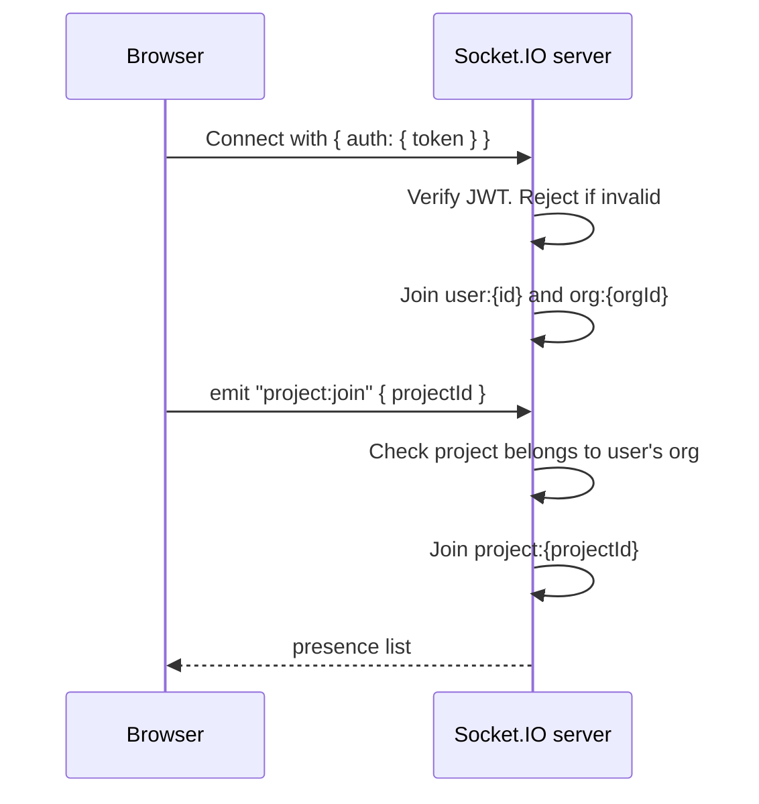
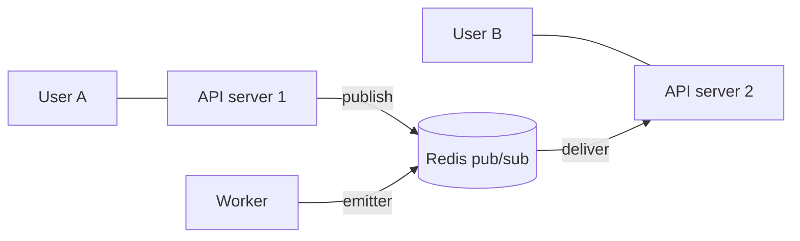

# 09. Real-Time

> How changes from one user appear instantly on everyone else's screen.

## In simple words

Normally the browser asks the server for data. With **WebSockets**, the connection stays open and the server can **push** data to the browser at any time. Socket.IO is a library on top of WebSockets that adds rooms, reconnection, and scaling across servers.

## Rooms

A room is a group of connections. You send an event to a room, and everyone in it receives it.

| Room | Who joins | Used for |
|---|---|---|
| `user:{userId}` | That user's open tabs | Personal notifications |
| `org:{orgId}` | Everyone in the org | Org-wide announcements |
| `project:{projectId}` | People viewing that project | Board changes, comments, presence |

## Connection flow



**Always check permissions before joining a room.** Otherwise anyone could listen to any project.

## Events

| Event | Room | Payload |
|---|---|---|
| `task:created` | project | Task |
| `task:updated` | project | Changed fields |
| `task:moved` | project | `{ taskId, status, position, actorId }` |
| `task:deleted` | project | `{ taskId }` |
| `comment:created` | project | Comment |
| `sprint:updated` | project | Sprint |
| `presence:update` | project | Users currently viewing |
| `ai:summary-ready` | project | `{ type, id }` |
| `github:pr-updated` | project | Pull request |
| `notification:new` | user | Notification |

Event types and payloads are defined in `packages/shared` so both sides agree.

## Who sends events

Events are sent **after the database write succeeds**, from the service layer:

```ts
const task = await tasksService.move(...);     // 1. save
emitToProject(projectId, "task:moved", {...}); // 2. then tell everyone
```

If you send before saving and the save fails, other users see a change that never happened.

The worker can't talk to browsers directly. It uses the Socket.IO **Redis emitter**, which publishes through Redis to whichever API server holds each connection.

## Scaling to more than one server

User A is connected to server 1. User B is connected to server 2. When A moves a card, server 1 must reach B.



The **`@socket.io/redis-adapter`** handles this. Every server publishes events to Redis, and every server receives them.

**Sticky sessions:** Socket.IO may start with HTTP long-polling before upgrading to WebSocket. With several servers, those polling requests must reach the same server. Either turn on sticky sessions on the load balancer, or configure clients to use the WebSocket transport only. DevPulse uses **WebSocket-only transport**, which is simpler on AWS.

## Reconnection and missed events

Connections drop (laptop sleeps, Wi-Fi changes). Socket.IO reconnects automatically, but events sent while disconnected are lost. The fix is simple: **on reconnect, refetch** the current page's data with TanStack Query (`queryClient.invalidateQueries`). The database is the source of truth. Events are only a shortcut.

## Presence

To show who else is viewing the board:

- On join, add the user to a Redis set `presence:project:{id}` with a short expiry.
- The browser sends a heartbeat every 30 seconds to refresh it.
- On disconnect, remove the user and broadcast `presence:update`.

Redis is used so presence works across all servers.

## Production checklist

- [ ] JWT check on connect
- [ ] Permission check before joining any room
- [ ] Redis adapter for multiple servers
- [ ] WebSocket-only transport (or sticky sessions)
- [ ] Events sent only after successful writes
- [ ] Refetch on reconnect
- [ ] Rate limit on client-sent events
- [ ] Load balancer idle timeout longer than the Socket.IO ping interval

## Interview talking points

- "Socket.IO rooms per project, with authorization on join."
- "Horizontally scaled with the Redis adapter. The worker emits through Redis too."
- "Events are a fast path. On reconnect the client refetches, so it never relies on events alone."

Next: [10. Background Jobs](10-background-jobs.md)
