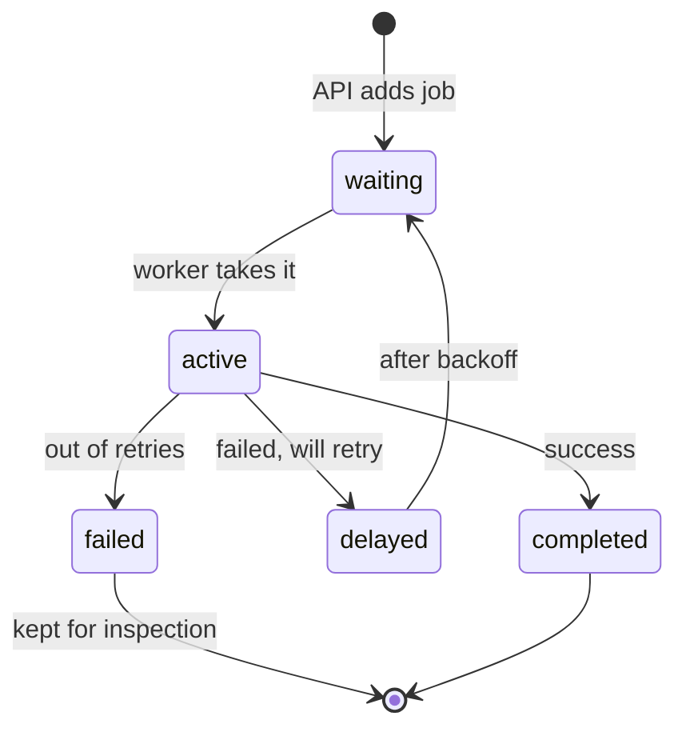

# 10. Background Jobs

> How slow work runs outside the request, and what happens when it fails.

## In simple words

A **queue** is a to-do list stored in Redis. The API adds jobs. The worker takes jobs one by one (or a few at a time), does the work, and marks them done. If a job fails, it is retried later. BullMQ is the library that manages this.

## The queues

| Queue | Jobs | Triggered by |
|---|---|---|
| `github` | `process-webhook`, `sync-repository`, `backfill-history` | Webhooks, linking a repo |
| `ai` | `summarize-pr`, `summarize-sprint` | PR opened or updated, sprint completed, manual button |
| `analytics` | `compute-daily-stats` | Schedule (every night), after sync |
| `notifications` | `send-notification`, `send-email` | Mentions, assignments, summaries ready |
| `maintenance` | `rebalance-positions`, `cleanup-expired-tokens` | Schedule |

Separate queues let you set different settings. For example, the AI queue runs few jobs at once to control cost, while the notifications queue runs many.

## Lifecycle of a job



## Retries with backoff

```ts
await aiQueue.add("summarize-pr", { pullRequestId }, {
  attempts: 5,
  backoff: { type: "exponential", delay: 10_000 }, // 10s, 20s, 40s, 80s...
  removeOnComplete: 1000,
  removeOnFail: 5000,
});
```

**Exponential backoff** waits longer after each failure. A service that is struggling gets time to recover instead of being hammered.

Not every error should be retried. A 400 from Gemini (bad request) will fail every time. Mark those as `UnrecoverableError` so they stop immediately.

## Idempotency: the most important rule

A job may run **more than once** (the worker crashes halfway, a webhook is delivered twice). Every job must be safe to repeat.

| Job | How it stays idempotent |
|---|---|
| Save commits | `upsert` on the unique `(repositoryId, sha)` |
| PR summary | Skip if a summary already exists for this PR's latest commit SHA |
| Webhook | Store GitHub's delivery ID. Skip if already seen |
| Notification | Use a job ID like `notify:{userId}:{eventId}`. BullMQ ignores duplicate job IDs |

## Concurrency and rate limits

```ts
new Worker("ai", processor, {
  concurrency: 3,
  limiter: { max: 30, duration: 60_000 }, // at most 30 jobs per minute
});
```

This keeps you inside Gemini and GitHub rate limits and controls cost.

## Scheduled jobs

BullMQ supports repeating jobs (like cron). Example: compute analytics at 01:00 UTC every day. Because the schedule is stored in Redis, it runs once even when several workers are running. A plain `setInterval` in each container would run it many times.

## Telling the user the result

Jobs that the user is waiting for update a status field in the database (`PENDING`, `COMPLETED`, `FAILED`) and emit a socket event when finished. The UI shows a spinner, then the result, or an error with a "Retry" button.

## Monitoring the queues

- **Bull Board** gives a web dashboard for queues: waiting, active, failed jobs, with the error for each. Mount it behind Admin auth, or only in non-production.
- Alert when the failed count or waiting count grows unusually (file 16).

## Redis setting you must know

BullMQ requires Redis `maxmemory-policy` set to **`noeviction`**. Otherwise Redis may delete queue data when memory runs low. If you also use Redis for caching, either use a separate Redis instance for cache, or set short expiry times on cache keys and size memory with headroom.

## Production checklist

- [ ] Every job is idempotent
- [ ] Retries with exponential backoff
- [ ] Non-retryable errors marked as unrecoverable
- [ ] Concurrency and rate limits per queue
- [ ] Failed jobs kept and visible
- [ ] Graceful shutdown: worker finishes the current job before exiting
- [ ] Redis `noeviction` for the queue instance
- [ ] Alerts on queue backlog and failures

## Interview talking points

- "Slow and unreliable work runs on BullMQ queues with retries, exponential backoff, and rate limiting."
- "All jobs are idempotent because at-least-once delivery means they can run twice."

Next: [11. GitHub Integration](11-github-integration.md)
