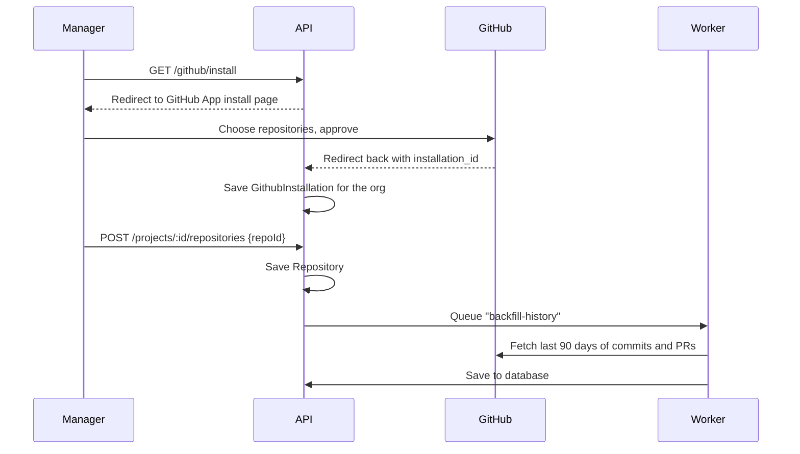
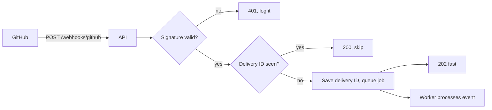

# 11. GitHub Integration

> How DevPulse reads repositories, commits, and pull requests from GitHub.

## In simple words

An organization **installs the DevPulse GitHub App** on the repositories it chooses. After that:

- GitHub **sends events** (webhooks) to DevPulse whenever someone pushes code or opens a PR.
- DevPulse can also **ask GitHub** for data through its API, for example to load past history.

## Why a GitHub App (and not a personal token)

| | GitHub App | OAuth App or personal token |
|---|---|---|
| Access scope | Only repos the org picks | Everything the user can see |
| Acts as | The app itself | A specific person |
| If the person leaves | Keeps working | Breaks |
| Rate limits | Grow with the installation | Per user |
| Webhooks | Set up automatically | Must be configured per repo |

GitHub recommends Apps for integrations like this. It is also a strong talking point.

Permissions to request (read-only is enough): **Metadata, Contents, Pull requests**. Subscribe to events: **push, pull_request, pull_request_review, installation, installation_repositories**.

## Install and link flow

## Authenticating as the App

1. DevPulse signs a short JWT with the App's **private key**.
2. It exchanges that JWT for an **installation access token** (valid for about an hour) for one organization's installation.
3. It calls the GitHub API with that token.

Octokit's `@octokit/app` package handles these steps and token refresh. Cache installation tokens in Redis until shortly before they expire.

## Webhooks

Rules:

1. **Verify the signature.** GitHub signs the body with your webhook secret and sends it in the `X-Hub-Signature-256` header. Compute the HMAC SHA-256 of the **raw** body and compare using a constant-time comparison (`crypto.timingSafeEqual`). This means the webhook route must read the raw body, before JSON parsing.
2. **Deduplicate.** Each delivery has an `X-GitHub-Delivery` ID. Store it and skip repeats.
3. **Respond fast.** GitHub expects a quick reply. Just queue the job and return. Do the work in the worker.

## What each event does

| Event | Action |
|---|---|
| `push` | Upsert commits. Link to tasks if the message mentions a task key like `DP-42`. |
| `pull_request` opened or synchronize | Upsert PR. Queue `summarize-pr`. |
| `pull_request` closed with merged | Mark merged. Optionally move linked task to Done. |
| `pull_request_review` | Record review time (used in analytics). |
| `installation` deleted | Mark installation inactive. |
| `installation_repositories` | Update which repos are available. |

## Linking code to tasks

If a branch name, PR title, or commit message contains a task key (`DP-42`), DevPulse links them. The task card then shows its PRs and their status. This is a simple regex, and it makes the product feel connected.

## Rate limits

GitHub returns `x-ratelimit-remaining` and `x-ratelimit-reset` headers. The worker reads them. When the limit is low, it delays the job until the reset time instead of failing. Octokit's throttling plugin does this for you.

## Backfill

When a repo is first linked, fetch recent history (for example, the last 90 days) with pagination in a background job. Mark progress so a restarted job continues where it stopped.

## Local development

GitHub can't reach `localhost`. Use a tunnel such as **smee.io** (recommended by GitHub for App development) or ngrok to forward webhooks to your machine.

## Production checklist

- [ ] GitHub App with least-privilege, read-only permissions
- [ ] Private key and webhook secret in a secrets manager, never in Git
- [ ] Signature verified on the raw body with constant-time comparison
- [ ] Delivery IDs deduplicated
- [ ] Webhook handler only queues jobs
- [ ] Rate-limit aware worker
- [ ] Resumable backfill
- [ ] Uninstall events handled

## Interview talking points

- "I used a GitHub App with installation tokens instead of personal tokens: scoped access, no dependency on one person's account."
- "Webhooks are verified with HMAC, deduplicated by delivery ID, and processed asynchronously."

Next: [12. AI Integration](12-ai-integration.md)
