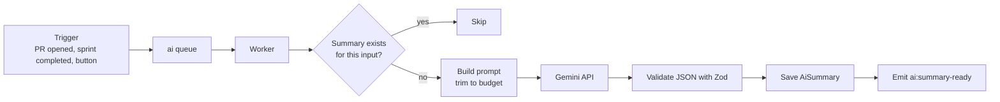

# 12. AI Integration

> How DevPulse uses Gemini to write PR and sprint summaries, reliably and at a sensible cost.

## In simple words

DevPulse collects data (a PR's diff, or a sprint's tasks and PRs), puts it into a carefully written **prompt**, sends it to Gemini, and saves the answer. This always happens in a background job, never during a web request.

## Two AI features

| Feature | Input | Output |
|---|---|---|
| **PR summary** | PR title, description, changed file list, diff (trimmed) | What changed, why, risk areas, review tips |
| **Sprint summary** | Sprint goal, tasks completed and not completed, merged PRs, dates | Delivered, slipped, blockers, highlights |

## Flow



## Code structure

```
modules/ai/
├── ai.client.ts          # the only file that talks to Gemini
├── prompts/
│   ├── prSummary.v1.ts
│   └── sprintSummary.v1.ts
├── ai.schemas.ts         # Zod schemas for the expected output
└── ai.service.ts         # builds input, calls client, saves result
```

Keeping Gemini behind one `ai.client.ts` means you could switch providers by changing one file.

## Structured output

Ask Gemini to return **JSON matching a schema**, not free text. The Gemini API supports this through a response schema setting. Then validate the result with Zod before saving.

```ts
const PrSummarySchema = z.object({
  overview: z.string(),
  changes: z.array(z.string()),
  risks: z.array(z.string()),
  reviewTips: z.array(z.string()),
});
```

**Why?** The frontend can render clean sections, and you can detect broken answers instead of showing garbage.

## Prompt design

A good prompt has:

1. **Role**: "You are a senior engineer reviewing a pull request."
2. **Task**: "Summarize the change for a reviewer."
3. **Rules**: "Only use information in the diff. If unsure, say so. Keep each point under 25 words."
4. **Input**, clearly marked: `<diff> … </diff>`
5. **Output format**: the JSON schema.

Prompts live in versioned files (`prSummary.v1.ts`). Each saved summary stores `promptVersion` and `model`, so you know which prompt produced which output.

## Handling large diffs

Diffs can be huge. Before sending:

- Drop generated and noisy files: lock files, `dist/`, minified files, images.
- Count approximate tokens and stay within a budget you set.
- If still too large, send the file list plus the most changed files, and say in the summary that it was partial.

## Cost and abuse control

| Control | How |
|---|---|
| Don't repeat work | Key PR summaries by the PR's head commit SHA. Same SHA, no new call. |
| Debounce | When several pushes arrive quickly, delay the job (for example 2 minutes) and only summarize the latest. |
| Limit concurrency | AI queue concurrency and rate limit (file 10). |
| Per-org quota | Count AI calls per org per day in Redis. Stop at a limit. |
| Track usage | Save token counts returned by the API with each summary. |

## Safety and privacy

- **Prompt injection**: a PR description could contain "ignore previous instructions". Treat all repository content as data. Clearly separate it from your instructions, and never let model output trigger actions (like merging or deleting). It only produces text to display.
- **Secrets in diffs**: skip files like `.env` and do a basic scan for obvious secret patterns before sending.
- **Data policy**: be clear in your docs that code snippets are sent to Google's Gemini API, and check Google's current data-use terms for the API tier you use.
- **Label AI output** in the UI as AI-generated.

## Failures

- Timeouts and 429 or 5xx errors: retry with backoff.
- Invalid JSON after retries: mark the summary `FAILED` and show "Retry" in the UI.
- Gemini down for a while: the rest of DevPulse keeps working. AI is an add-on, never a dependency of core features.

## Testing AI code

- Unit test the prompt builder and the trimming logic (no API call needed).
- Mock `ai.client.ts` in service tests.
- Keep a small set of real example PRs and check output quality manually when you change a prompt version.

## Production checklist

- [ ] All AI calls in background jobs
- [ ] Structured JSON output validated with Zod
- [ ] Versioned prompts, `model` and `promptVersion` stored
- [ ] Input trimming and token budget
- [ ] Caching by commit SHA, debouncing, quotas
- [ ] Prompt injection treated as a real risk
- [ ] API key in a secrets manager
- [ ] Graceful failure with retry in the UI

## Interview talking points

- "AI calls run asynchronously with structured output validated by Zod, versioned prompts, and caching by commit SHA to control cost."
- "I treated repository content as untrusted input to defend against prompt injection."

Next: [13. Analytics](13-analytics.md)
