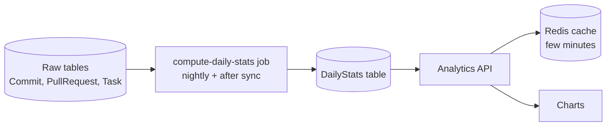

# 13. Analytics

> Which productivity numbers DevPulse shows, and how it computes them efficiently.

## In simple words

DevPulse turns task and GitHub data into charts. Raw data is summarized into a small **daily stats** table every night, so charts load fast without scanning millions of rows.

## Choose metrics carefully

Bad metrics push people to game them. Lines of code or commit counts alone reward noise. DevPulse focuses on **flow and team health**, and shows individual numbers mainly to the developer themselves.

| Metric | Meaning | Source |
|---|---|---|
| **PR cycle time** | Time from PR opened to merged | PullRequest |
| **Time to first review** | Time from PR opened to first review | Review events |
| **PR size** | Lines added plus deleted | PullRequest |
| **Throughput** | PRs merged and tasks completed per week | PullRequest, Task |
| **Sprint completion** | Story points done vs planned | Task, Sprint |
| **Burndown** | Remaining points per day in a sprint | Task status history |
| **Work in progress** | Tasks in progress per person | Task |
| **Activity** | Commits, PRs, reviews per day | Commit, PullRequest |

These are inspired by industry research on delivery performance (for example the DORA metrics), adapted to what DevPulse can measure.

## How it is computed



### The aggregate table

```prisma
model DailyStats {
  id                 String   @id @default(uuid())
  organizationId     String
  projectId          String
  userId             String?          // null means whole team
  date               DateTime @db.Date
  commits            Int      @default(0)
  prsOpened          Int      @default(0)
  prsMerged          Int      @default(0)
  reviewsGiven       Int      @default(0)
  tasksCompleted     Int      @default(0)
  pointsCompleted    Int      @default(0)
  medianCycleTimeMin Int?

  @@unique([projectId, userId, date])
  @@index([organizationId, date])
}
```

- The job **upserts** rows for a day, so running it twice gives the same result (idempotent).
- A chart for 90 days reads at most 90 rows per user, which is fast.
- Today's numbers can be computed live from raw tables, since one day of data is small.

## Burndown needs history

To draw a burndown, you need to know when each task changed status. Record every status change in the `Activity` table (or a dedicated `TaskStatusChange` table). The burndown is then computed from those changes.

## Mapping GitHub users to DevPulse users

Commits and PRs come with GitHub usernames. Link them through `User.githubUserId`, which is set when a user signs in with GitHub. Unlinked authors are shown by GitHub username.

## Access rules

| Who | Sees |
|---|---|
| Developer | Own stats and team totals |
| Manager, Admin | Team stats and each member's stats |

## Production checklist

- [ ] Pre-aggregated daily table, idempotent job
- [ ] Indexes on the aggregate table
- [ ] Short Redis cache on analytics responses
- [ ] Clear time zone handling (store UTC, display in the user's zone)
- [ ] Permission checks for individual stats
- [ ] Metrics explained in the UI with tooltips

## Interview talking points

- "I pre-aggregated metrics into a daily stats table with a nightly idempotent job, so dashboards query a few hundred rows instead of scanning raw events."
- "I chose flow metrics like cycle time and review time over vanity metrics like lines of code."

Next: [14. Notifications and Activity](14-notifications-and-activity.md)
