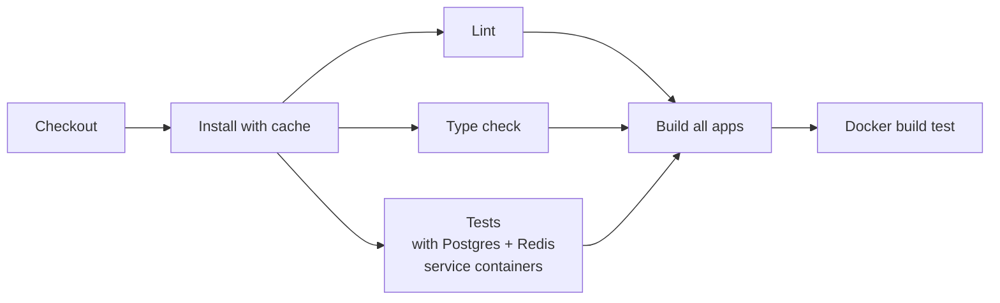
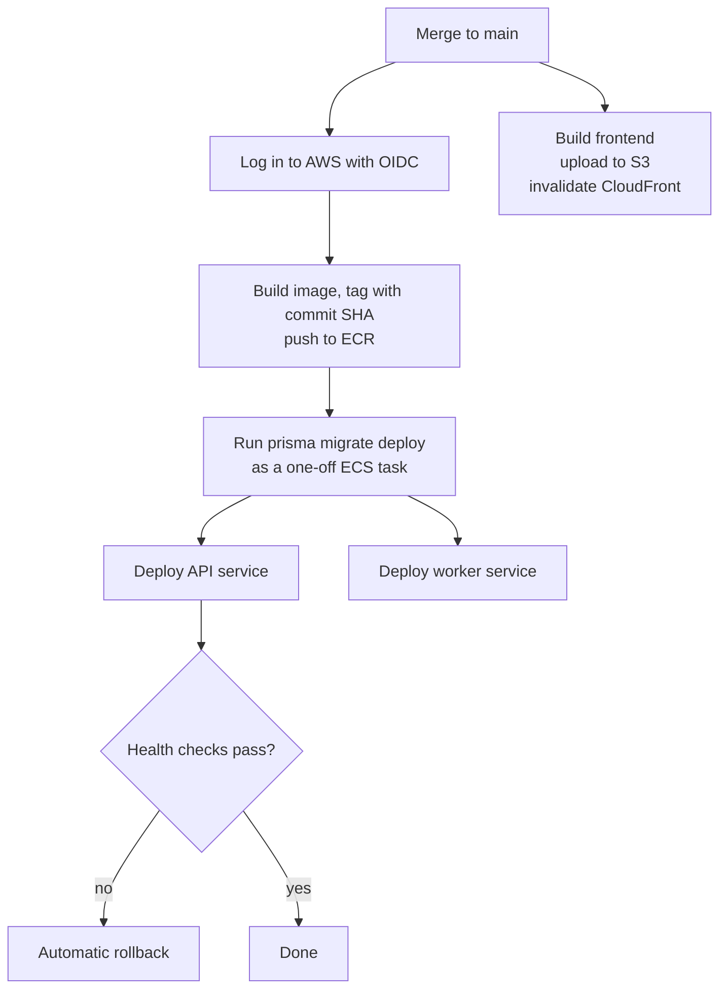

# 18. DevOps and CI/CD

> How code goes from your laptop to production, automatically and safely.

## In simple words

- **Docker** packages each app with everything it needs, so it runs the same on your laptop and on AWS.
- **CI** (Continuous Integration) checks every change: lint, type check, tests, build.
- **CD** (Continuous Deployment) ships changes that pass CI to the servers.

## Environments

| Environment | Purpose | Deployed when |
|---|---|---|
| **Local** | Development | You run `pnpm dev` |
| **Staging** | Test like production | Merge to `main` |
| **Production** | Real users | Manual approval in GitHub Actions, or a version tag |

For a portfolio project, you can start with local and production only, and add staging later.

## Local development with Docker Compose

```yaml
# docker-compose.yml (local only)
services:
  postgres:
    image: postgres:17
    environment:
      POSTGRES_USER: devpulse
      POSTGRES_PASSWORD: devpulse
      POSTGRES_DB: devpulse
    ports: ["5432:5432"]
    volumes: [pgdata:/var/lib/postgresql/data]
  redis:
    image: redis:7
    command: ["redis-server", "--maxmemory-policy", "noeviction"]
    ports: ["6379:6379"]
volumes:
  pgdata:
```

The apps run directly with `pnpm dev` for fast reloads. Only the databases run in Docker.

## Production Dockerfile (API and worker)

A **multi-stage build** keeps the final image small: one stage installs and builds, the last stage copies only what is needed to run.

```dockerfile
FROM node:22-alpine AS build
WORKDIR /app
RUN corepack enable
COPY . .
RUN pnpm install --frozen-lockfile
RUN pnpm --filter api build && pnpm --filter api exec prisma generate

FROM node:22-alpine AS runtime
WORKDIR /app
ENV NODE_ENV=production
COPY --from=build /app/... ./     # only built output and production dependencies
USER node                          # do not run as root
EXPOSE 4000
CMD ["node", "dist/server.js"]
```

The **same image** runs both the API and the worker. Only the start command differs (`dist/server.js` or `dist/worker.js`).

The frontend isn't a container. It is static files uploaded to S3.

## Branching

- `main` is always deployable.
- Work on short-lived feature branches, open a pull request, CI must pass, then merge.
- Protect `main`: require PR and passing checks.
- Use **Conventional Commits** (`feat:`, `fix:`, `chore:`) for clear history.

## CI pipeline (every pull request)



Also enabled: Dependabot for dependency updates, GitHub secret scanning, and an image vulnerability scan.

## CD pipeline (merge to main)



Key points:

- **OIDC**: GitHub Actions gets short-lived AWS credentials through a trust relationship. No AWS access keys are stored in GitHub.
- **Tag images with the commit SHA**, not only `latest`, so you always know what is running and can roll back.
- **Migrations run before new code**, and must be backward-compatible with the old code still running (file 06).
- **Rolling deployment** on ECS: new containers start, pass health checks, then old ones stop. The ECS deployment circuit breaker can roll back automatically if new containers fail.

## Infrastructure as Code

All AWS resources are defined in **Terraform** in the `infra/` folder. Benefits:

- The setup is reviewable in pull requests.
- You can destroy and recreate the whole environment, which saves money when you aren't demoing.
- It shows real DevOps skill on a resume.

Store Terraform state in an S3 bucket with locking.

## Production checklist

- [ ] Multi-stage Dockerfile, non-root user, small base image
- [ ] One image for API and worker
- [ ] CI on every PR: lint, typecheck, test, build
- [ ] Protected `main` branch
- [ ] OIDC to AWS, no stored keys
- [ ] Images tagged by commit SHA
- [ ] Migrations as a deploy step
- [ ] Rolling deploys with health checks and automatic rollback
- [ ] Terraform for all infrastructure

## Interview talking points

- "CI runs lint, type checks, and integration tests against real Postgres and Redis. CD uses OIDC to AWS, pushes SHA-tagged images to ECR, runs migrations, and does rolling ECS deploys with automatic rollback."

Next: [19. AWS Deployment](19-aws-deployment.md)
