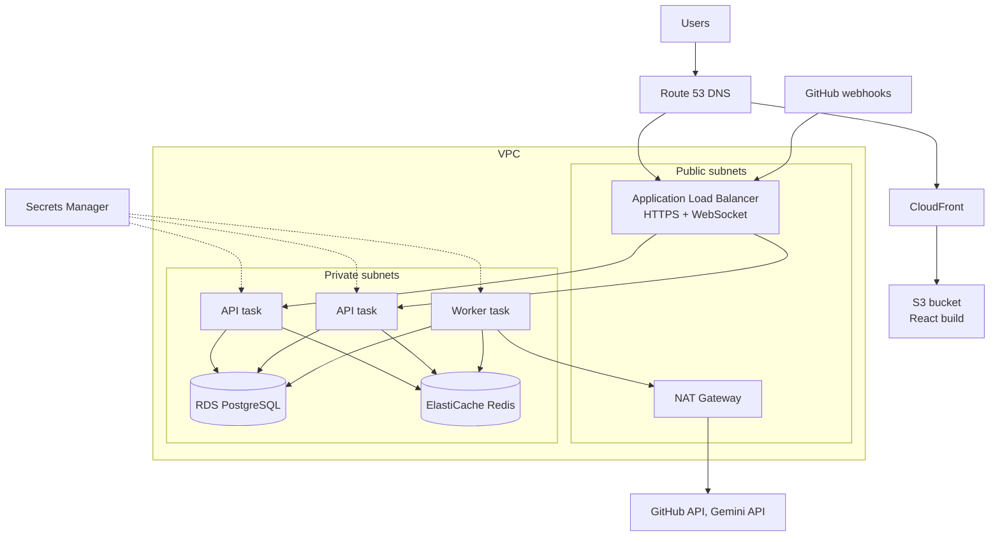

# 19. AWS Deployment

> Where each part of DevPulse runs in AWS, and how traffic and data move.

## In simple words

| DevPulse part | AWS service |
|---|---|
| Frontend files | **S3** (storage) + **CloudFront** (global cache, HTTPS) |
| API and worker containers | **ECS Fargate** (runs containers without managing servers) |
| Docker images | **ECR** (image registry) |
| Traffic routing and HTTPS | **Application Load Balancer (ALB)** + **ACM** (free TLS certificates) |
| PostgreSQL | **RDS for PostgreSQL** |
| Redis | **ElastiCache for Redis** (or Valkey, its compatible successor engine) |
| Secrets | **Secrets Manager** |
| Logs and alarms | **CloudWatch** + **SNS** |
| Domain | **Route 53** |
| Email | **SES** |

## Architecture diagram

## Networking explained

- A **VPC** is your private network in AWS.
- **Public subnets** hold only things that must face the internet: the load balancer and the NAT gateway.
- **Private subnets** hold the containers, database, and Redis. Nothing from the internet can reach them directly.
- The **NAT gateway** lets private containers make outgoing calls (to GitHub and Gemini) without being reachable from outside.
- **Security groups** are firewalls per resource:
  - ALB accepts 443 from anywhere.
  - API accepts traffic only from the ALB.
  - RDS accepts 5432 only from API and worker.
  - Redis accepts 6379 only from API and worker.

Use at least **two availability zones** (separate data centers in the same region) so one failure doesn't take the app down.

## Domains

| Domain | Points to |
|---|---|
| `app.devpulse.dev` (example) | CloudFront (frontend) |
| `api.devpulse.dev` (example) | ALB (API and WebSocket) |

Because the frontend and API are on different subdomains, set the refresh cookie's domain to the parent domain and configure CORS for the frontend origin.

## ECS services

| Service | Tasks | Scaling |
|---|---|---|
| `devpulse-api` | 2 or more in production | Auto-scale on CPU or request count |
| `devpulse-worker` | 1 or more | Scale on queue backlog (custom metric) |
| `devpulse-migrate` | One-off task per deploy | Not a long-running service |

ALB settings for real-time: WebSockets are supported by default. Raise the **idle timeout** above the Socket.IO ping interval, and set the health check path to `/health/ready`.

## Database and Redis

- **RDS**: automated backups with point-in-time recovery, encryption at rest, Multi-AZ standby in production.
- **ElastiCache**: in a private subnet, encryption in transit, `maxmemory-policy noeviction` for BullMQ (file 10).
- **Connection limits**: each API and worker task opens a pool of database connections. Total = tasks × pool size, which must stay below the RDS limit. Add **RDS Proxy** if you scale to many tasks.

## Cost (be careful)

Several services bill **per hour even when idle**: the ALB, the NAT gateway, RDS, and ElastiCache. A full production-style setup can cost noticeably more than a student budget expects. Check current prices with the **AWS Pricing Calculator** for your region before you deploy.

Ways to keep a portfolio deployment cheap:

| Option | Trade-off |
|---|---|
| Single-AZ, smallest instance sizes | Less resilient. Fine for a demo |
| One NAT gateway instead of one per AZ | Small availability risk |
| `terraform destroy` when not demoing | Must redeploy before interviews |
| Check AWS Free Tier eligibility for your account | Limits and terms change, so read the current page |
| Set an **AWS Budget alert** on day one | None. Always do this |

Document in your README which production features you designed for but scaled down for cost. Interviewers respect that judgment.

## Production checklist

- [ ] Private subnets for containers and data stores
- [ ] Least-privilege security groups
- [ ] Two availability zones
- [ ] HTTPS everywhere with ACM certificates
- [ ] Secrets Manager for all secrets
- [ ] RDS backups, encryption, Multi-AZ (production)
- [ ] ALB idle timeout and health checks tuned
- [ ] Auto scaling for API
- [ ] AWS Budget alert
- [ ] Everything in Terraform

## Interview talking points

- "Containers run on ECS Fargate in private subnets behind an ALB. RDS and ElastiCache are private with security groups allowing only the app. The frontend is on S3 and CloudFront. Everything is Terraform-managed."
- "I scaled the demo environment down for cost but designed it to go Multi-AZ by changing variables."

Next: [20. Build Roadmap](20-build-roadmap.md)
